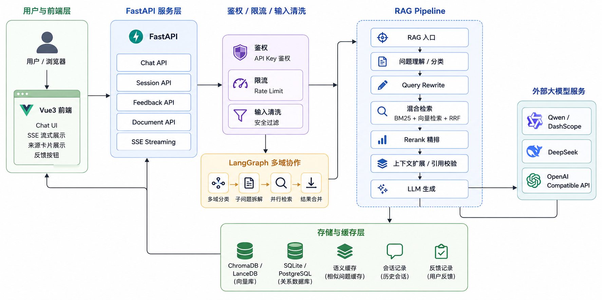

# lawyerAgents

lawyerAgents 是一个面向中国法律场景的 RAG Agent 项目，不是单纯的法律问答 Demo。项目把法律服务任务组织成一条可演示、可观测、可评测的主链路：

```text
法律问答 -> 案情分析 -> 文书生成 -> 评测反馈闭环
```

核心价值是让模型回答尽量建立在可追踪的法条、司法解释和参考案例之上，并把检索、融合、精排、引用校验、生成和反馈指标显式暴露出来，方便定位法律 RAG 的真实质量问题。



更详细的系统架构请查看：[docs/ARCHITECTURE.md](docs/ARCHITECTURE.md)。

## 核心任务

### 1. 法条问答

面向“试用期多久”“合同违约怎么处理”“刑事立案和民事追偿能否并行”等问题，系统通过 RAG 检索相关法条和司法解释，并可按配置补充官方精选案例作为参考，生成带来源的结构化回答。

输出重点：

- 初步结论和适用条件。
- 法律依据和条文来源。
- 风险提示、证据建议和不确定性说明。
- `sources` 来源卡片，避免只给结论不给依据。

### 2. 案情分析

面向较长的事实描述，系统先识别用户意图，再进入案情分析链路：拆解法律主张、按主张并行检索、交叉分析，最后生成结构化案情分析报告。

当前实现会返回 `case_state`、`analysis_result`、`analysis_markdown`、`case_analysis_id` 等结构化信息。`analysis_result` 包含案情摘要、案件类型、风险等级、争议焦点/请求、证据清单、缺失信息、下一步建议和可生成文书建议；JSON 解析失败时会降级保留 Markdown 报告并返回 warning。劳动争议场景下，分析结果可以继续触发劳动人事争议仲裁申请书生成。

### 3. 法律文书生成

当前闭环重点支持劳动人事争议仲裁申请书。系统可以从案情分析结果或用户补充信息中抽取字段，字段不足时返回 `need_more_info`、缺失字段和追问；字段充足时生成 Markdown 文书草稿。

文书生成不是脱离案情的模板填充，而是接在“案情分析 -> case_state -> 字段抽取 -> 文书草稿/追问”之后，便于演示一个完整法律任务流。

## RAG 技术链路

项目的法律问答主流程不是纯向量召回，而是混合检索与引用校验组合：

```text
问题分类 / Query Rewrite
  -> BM25 关键词召回
  -> Vector 语义召回
  -> RRF 融合
  -> Rerank 精排
  -> 上下文扩展
  -> 引用校验
  -> LLM 生成
```

- **BM25**：适合法条编号、罪名、时效、机构名称、法律术语等精确匹配。
- **Vector**：适合口语化表达、事实描述和语义近似问题。
- **RRF**：融合两路召回结果，降低单一路召回偏差。
- **Rerank**：控制最终进入上下文的法律片段质量，减少噪声。
- **上下文扩展**：补充相邻条文、款项、引用条文和必要司法解释。
- **引用校验**：检查回答中显式法名和条号是否能被 `sources` 支撑。

详细流程请查看：[docs/RAG_PIPELINE.md](docs/RAG_PIPELINE.md)。

## LangGraph 多域协作

项目用 LangGraph 处理跨领域法律问题：

- 单域问题走快速路径，直接进入检索和生成，降低延迟。
- 多域问题先拆成多个领域子问题，再并行检索。
- 多路检索结果去重、合并后进入统一生成上下文。
- 可配置领域优先级和加权合并，用于刑事、行政、治安等优先级更高的场景。

这使项目能处理劳动 + 刑事、合同 + 公司、婚姻 + 治安 + 民事诉讼等复合型问题，而不是把复杂案情压成一个单一领域回答。

## SSE 可观测输出

前端聊天页会解析后端 SSE 事件，并实时展示 RAG 过程：

- `meta`：领域、意图、缓存命中、多域信息、文书类型等。
- `substep`：分类、改写、BM25、向量检索、RRF、Rerank、上下文扩展、引用校验、生成等阶段进度。
- `token`：Markdown 回答正文流式输出。
- `done`：最终 `sources`、`risk_warning`、`timings`、`record_id`、`case_state`、`document_result` 等。
- `error`：失败步骤和可读错误信息。

这部分既是用户体验，也是工程调试入口：可以看到系统到底卡在召回、排序、生成还是后处理。

## 评测反馈闭环

项目提供轻量评测脚本和评测集，关注法律 RAG 最核心的四类信号：

- `expected_laws`：期望命中的法律名称。
- `expected_articles`：期望命中的具体条文。
- `citation_supported_rate`：回答中显式引用有多少能被 `sources` 支撑。
- `latency_ms` / `p95_latency_ms`：端到端延迟与长尾延迟。

评测输出包含逐题 JSONL 和 Markdown 报告，便于把失败样例回流到检索、排序、引用校验或提示词优化中。更多说明见：[docs/EVALUATION.md](docs/EVALUATION.md) 和 [eval/README.md](eval/README.md)。

## 推荐演示路径

详细现场讲解稿见：[docs/DEMO_SCRIPT.md](docs/DEMO_SCRIPT.md)。

1. **法条问答**：输入“试用期最长可以约定多久？”观察 BM25 + Vector + RRF + Rerank 的 `substep`，以及回答后的来源卡片。
2. **跨领域问答**：输入“公司高管把员工工资款挪走了，员工能劳动仲裁还是报警？”观察 LangGraph 多域拆解和合并生成。
3. **案情分析**：输入一段劳动争议案情，例如未签劳动合同、拖欠工资、口头辞退，观察系统输出结构化分析报告和 `case_state`。
4. **文书生成**：从劳动案情分析结果继续生成劳动人事争议仲裁申请书；如果字段不足，系统会先追问缺失信息。
5. **评测回归**：启动后端后运行 `python eval/run_eval.py`，查看 `expected_laws`、`expected_articles`、`citation_supported_rate` 和延迟报告。

## 适合简历描述的项目亮点

- 构建面向中国法律场景的 RAG Agent，将法条问答、案情分析、劳动仲裁文书生成和评测反馈串成完整任务闭环。
- 设计 BM25 + Vector + RRF + Rerank 的混合检索链路，并加入上下文扩展与引用校验，降低法律问答中的错引、漏引和无依据回答风险。
- 基于 LangGraph 实现单域快速路径与多域问题拆解，对跨领域案情进行并行检索和合并生成。
- 使用 SSE 暴露 `meta / substep / token / done / error`，让 RAG 检索、精排、生成和异常过程可观测。
- 建立轻量评测体系，使用 `expected_laws`、`expected_articles`、`citation_supported_rate`、`latency` 等指标做回归验证。
- 工程上支持 FastAPI + Vue3 前后端分离、SQLite / PostgreSQL 存储、语义缓存、会话记录、反馈管理和 Docker Compose 部署。

## 快速启动

### 环境要求

- Python 3.11
- Node.js 18+
- 可用的模型服务 Key，例如 Qwen / DashScope

### 安装后端依赖

```powershell
pip install -r requirements.txt
```

### 配置环境变量

```powershell
copy .env.example .env
```

编辑 `.env`，填入模型服务 Key。不要把真实 Key 提交到 GitHub。

### 启动后端

```powershell
python run.py
```

后端默认地址：

```text
http://localhost:9000
```

### 启动前端

```powershell
cd frontend
pnpm install
pnpm run dev
```

前端默认地址通常为：

```text
http://localhost:3000
```

如果 3000 端口已被占用，Vite 会自动切换到 3001、3002 等后续端口。

## 配置

常用配置请参考 `.env.example`：

```env
LLM_PROVIDER=qwen
EMBEDDING_PROVIDER=qwen
QWEN_API_KEY=
QWEN_CHAT_MODEL=qwen3-max
QWEN_EMBEDDING_MODEL=text-embedding-v4
QWEN_RERANKER_MODEL=gte-rerank-v2
ENABLE_AUTHORITY_WEIGHTING=true
AUTHORITY_BOOST_FACTOR=0.08
DATA_DIR=./data
CHROMA_PERSIST_DIR=./chroma_db
DATABASE_URL=
```

完整部署配置请查看：[docs/DEPLOYMENT.md](docs/DEPLOYMENT.md)。

## 项目结构

```text
lawyerAgents/
├── app/                  # FastAPI 后端、RAG、LangGraph、案情分析和文书链路
├── frontend/             # Vue3 前端
├── data/                 # 法律知识库、司法解释、官方精选案例等本地数据
├── eval/                 # 评测集、评测脚本和报告
├── scripts/              # 数据构建、案例导入等脚本
├── docs/                 # 架构、流程、部署、评测和设计决策文档
├── run.py                # 后端启动入口
├── requirements.txt
└── README.md
```

## 技术栈

| 模块 | 技术 |
| --- | --- |
| 后端服务 | FastAPI、Pydantic |
| RAG 编排 | LangChain、LangGraph |
| 检索增强 | BM25、ChromaDB、LanceDB、RRF、Rerank |
| 模型接入 | Qwen / DashScope、DeepSeek、OpenAI Compatible |
| 数据存储 | SQLite、PostgreSQL |
| 前端 | Vue3、Vite、TailwindCSS |
| 流式输出 | SSE |

## 文档

- [系统架构说明](docs/ARCHITECTURE.md)
- [RAG Pipeline 设计](docs/RAG_PIPELINE.md)
- [设计决策说明](docs/DESIGN_DECISIONS.md)
- [演示脚本](docs/DEMO_SCRIPT.md)
- [数据源权威分层](docs/DATA_SOURCES.md)
- [语义缓存策略](docs/CACHE_STRATEGY.md)
- [RAG 评测说明](docs/EVALUATION.md)
- [部署说明](docs/DEPLOYMENT.md)

## Roadmap

- [x] 增加轻量 RAG 评测脚本与报告
- [x] 增加 Docker Compose 部署
- [x] 增加基础单元测试和 API 测试覆盖
- [ ] Java Spring Boot 网关层属于后续企业集成方向，当前阶段不作为主线能力
- [ ] PDF / 表格 / 结构化文档解析属于后续数据接入增强，当前阶段以现有法条和案例库为主
