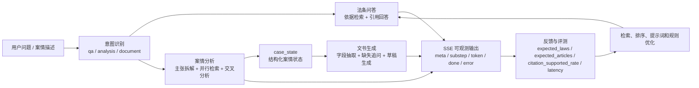
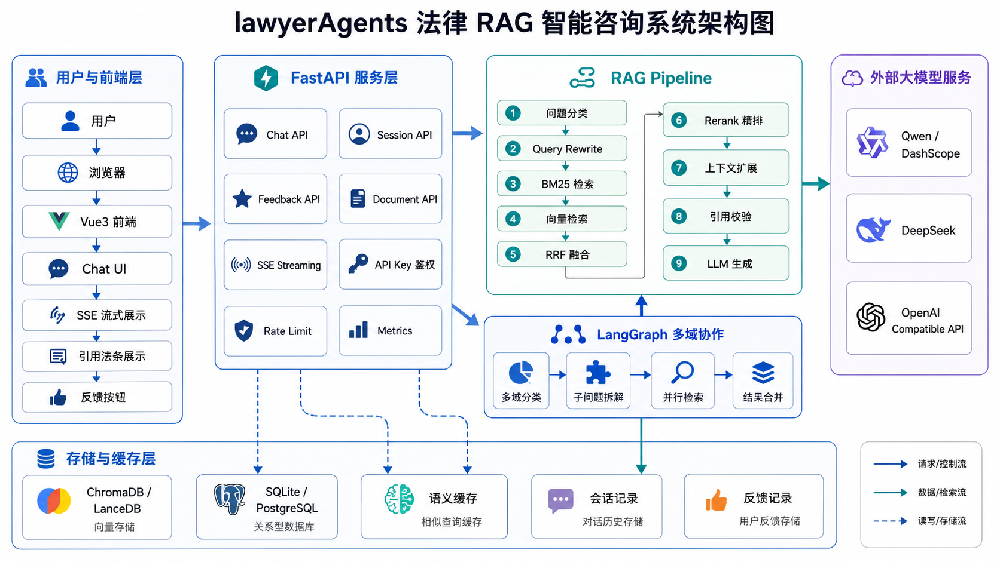
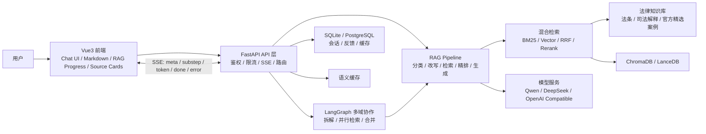

# 系统架构说明

lawyerAgents 是一个面向中国法律场景的 RAG Agent 项目。系统以 FastAPI 为服务入口，结合 LangChain、LangGraph、BM25、向量检索、RRF、Rerank、ChromaDB / LanceDB、SQLite / PostgreSQL、Vue3 和 SSE 流式输出，把法律服务任务组织为：

```text
法律问答 -> 案情分析 -> 文书生成 -> 评测反馈闭环
```

当前项目重点覆盖三类核心任务：法条问答、案情分析、法律文书生成。其中法律文书生成的闭环演示重点是劳动人事争议仲裁申请书。

## 产品主链路

业务上，项目不是把所有能力平铺成一个聊天 Demo，而是围绕“用户问题如何转化为可依据、可继续办理、可评测的法律任务结果”来组织。



## 三条核心任务链路

### 法条问答链路

```text
用户问题
  -> 输入清洗 / 意图识别 / 领域分类
  -> Query Rewrite
  -> BM25 + Vector
  -> RRF 融合
  -> Rerank 精排
  -> 上下文扩展 + 引用校验
  -> LLM 生成
  -> answer + sources + risk_warning
```

该链路适合短问答、法条解释、跨领域法律咨询和多轮追问。重点是让最终回答能回到 `sources`，而不是只输出模型判断。

### 案情分析链路

```text
长案情描述
  -> analysis intent
  -> 拆解法律主张
  -> 每个主张并行检索
  -> 交叉分析
  -> 生成 Markdown 分析报告
  -> 追加结构化 JSON
  -> 解析为 analysis_result
  -> case_state + analysis_result + sources
```

案情分析会同时保留 Markdown 报告和结构化结果。`analysis_result` 面向前端卡片和后续文书复用，包含 `case_summary`、`case_type`、`risk_level`、`legal_relationships`、`claims`、`evidence_checklist`、`next_actions`、`missing_information`、`document_suggestions` 等字段。模型输出的 JSON 代码块会被解析；如果 JSON 异常，系统会记录 `warnings` 并继续返回 Markdown 报告，不阻断主流程。

劳动争议案情会补充可用于文书生成的 `case_state`，并保存 `case_analysis_id` 供后续接口复用。

### 法律文书生成链路

```text
case_state / 用户补充信息
  -> document intent 或 /api/document
  -> 文书类型解析
  -> 字段抽取
  -> 字段槽位状态判断
  -> need_more_info 追问 或 ready 草稿
  -> document_result
```

当前闭环主要支持劳动人事争议仲裁申请书。后端先从 `case_state`、案情分析结果和用户补充信息中抽取字段，再判断 `known / missing / partial / uncertain` 四类槽位状态。姓名、联系电话、被申请人名称、被申请人地址、入职时间、月工资、仲裁请求、事实与理由等核心字段缺失时不会硬生成，而是返回缺失字段、当前已知字段、最多 3 个追问和 pending document 状态；身份证号、离职时间等可暂缺字段会在槽位状态中提示，并在文书中保留 `【待补充】` 占位。字段充分时生成 Markdown 劳动仲裁申请书草稿。

## 1. 总体架构



图片版简化架构图用于 README 首页展示，完整架构图用于本文档说明。图片版架构图的生成提示词保存在 `docs/assets/architecture.prompt.md`。

## Mermaid 可编辑版本



## 2. 模块职责

### Vue3 前端

负责聊天界面、模式选择、SSE 流式展示、Markdown 渲染、RAG 过程面板、来源卡片、风险提示、参考案例展示、反馈入口以及劳动仲裁申请书预览等交互。

前端会解析 `meta / substep / token / done / error` 事件。`substep` 用于展示问题分类、Query Rewrite、BM25 检索、向量检索、RRF 融合、Rerank 精排、上下文扩展、引用校验和生成回答等阶段的状态和耗时。`done` 后展示 `sources` 来源卡片和 `risk_warning` 风险提示。

### FastAPI API 层

负责 HTTP / SSE 接口、请求校验、输入清洗、API Key 鉴权、限流、指标统计、会话读写和不同业务流程的路由分发。

### RAG Pipeline

负责法律咨询主流程编排，包括问题分类、Query Rewrite、混合检索、RRF 融合、Rerank 精排、上下文扩展、引用校验和 LLM 生成。

### LangGraph 多域协作

用于处理跨领域法律问题。系统可将复杂问题拆成多个领域子问题，并行检索后合并结果，避免只按单一领域回答导致遗漏。

### 混合检索模块

BM25 适合精确术语、罪名、法条编号和时效关键词；向量检索适合口语化和语义相近表达；RRF 融合用于减少单一路召回偏差，Rerank 用于控制最终上下文质量。

### 数据源权威分层

系统在 loader、sources 标准化和 Rerank 后候选选择阶段识别 `source_level`，包括 `law`、`judicial_interpretation`、`official_case`、`legacy_case`、`local_document` 和 `unknown`。现行法律法规和司法解释优先作为主要依据，官方案例和历史案例只作为辅助参考。Rerank 后仅做轻量 `authority_weight` 调整，用于相近分候选排序，不替代 BM25 + Vector + RRF + Rerank 的语义相关性。详细规则见 [DATA_SOURCES.md](DATA_SOURCES.md)。

### 语义缓存

对重复或高度相似问题进行缓存命中，减少重复检索和模型调用。缓存命中包括精确 hash 命中和 embedding 相似命中。

缓存按 `intent + domain + normalized_question + index_version + policy_version + document_type` 隔离。QA 默认可缓存，案情分析和文书生成默认不缓存，避免旧 QA 回答遮蔽结构化任务或复用个案结论。详细策略见 [CACHE_STRATEGY.md](CACHE_STRATEGY.md)。

### 会话与反馈存储

默认可使用 SQLite，本地演示部署简单；配置 `DATABASE_URL` 后可使用 PostgreSQL。存储内容包括会话记录、反馈记录、语义缓存等。

### 评测与反馈闭环

评测脚本会请求本地 API 或复用 RAG 初始化逻辑，记录 `expected_laws`、`expected_articles`、`citation_supported_rate`、`latency_ms`、`p95_latency_ms` 等指标。用户反馈、回答修正和评测失败样例可以回流到检索、排序、引用校验、提示词和规则优化中。

### 模型服务适配层

支持 Qwen / DashScope、DeepSeek、OpenAI Compatible 等模型服务。不同模型能力可用于主回答、摘要、Embedding、Rerank 等环节。

## 3. 请求链路

### 普通问答请求链路

```text
用户
  -> Vue3 前端
  -> FastAPI
  -> 输入清洗 / 鉴权 / 限流
  -> RAG Pipeline
  -> BM25 + 向量检索
  -> RRF 融合 + Rerank
  -> 上下文扩展 + 引用校验
  -> LLM 生成
  -> 返回 answer + sources + risk_warning
```

### SSE 流式请求链路

```text
用户
  -> Vue3 前端
  -> FastAPI Streaming API
  -> event: meta
  -> event: substep
  -> event: token
  -> event: done
  -> event: error
```

其中：

- `meta`：领域、缓存命中、多域标记等元信息。
- `substep`：分类、改写、BM25、向量检索、RRF、精排、上下文扩展、引用校验、生成等阶段进度；字段包括 `step`、`label`、`status`、`duration_ms`、`input_count`、`output_count`、`message`。
- `token`：模型生成内容。
- `done`：最终 sources、risk_warning、timings、record_id。案情分析链路会额外返回 `analysis_result`、`analysis_markdown`、`case_state`、`case_analysis_id` 和非致命 `warnings`。文书链路会额外返回 `document_type`、`extracted_fields`、`field_status`、`field_slots`、`missing_fields`、`document_markdown`、`can_export` 和 `document_result`。
- `error`：失败 step 和可读错误信息。

## 4. 数据流

### 法律文档进入向量库

本地法律文档放在 `data/` 下，经文档加载、文本切分、条号提取后构建向量索引，并保存到 ChromaDB / LanceDB。司法解释和官方精选案例可以使用独立索引或独立数据结构按需检索，避免启动时全量读取过大数据。

### 用户问题进入 RAG Pipeline

用户问题先经过输入清洗、意图识别和领域分类。单域问题进入快速路径，多域问题进入 LangGraph 多域协作流程。

### 检索结果进入 LLM 上下文

BM25 和向量检索结果经 RRF 融合和 Rerank 精排后，系统补充相邻法条、款项上下文和必要司法解释，再拼装为 LLM 上下文。

Rerank 后的最终候选会补齐权威分层元数据，并对相近候选做轻量权威加权：法律法规、司法解释优先于历史案例，未知来源不会被完全丢弃，但权重较低。

### 回答、引用、反馈持久化

回答生成后，系统返回 Markdown `answer`、`sources`、`risk_warning`、`case_results` 等结构化结果。`sources` 优先使用统一 `SourceItem` 结构，包含 `law_name`、`article_no`、`text`、`source_type`、`source_level`、`authority_weight`、`authority_label`、`confidence` 等字段，前端据此渲染来源卡片。若最终依据主要来自历史案例、本地资料或未知来源，`risk_warning` 会追加效力提示。会话记录、用户反馈和语义缓存写入 SQLite 或 PostgreSQL，便于后续追踪和优化。

## 5. 后续 Java 网关层规划

Java Spring Boot 网关层属于 Roadmap，当前不是已完成能力。未来可在 Python RAG 服务前增加 Java 网关，负责：

- 用户认证
- 权限管理
- 会话管理
- 问答记录主库
- SSE 转发
- 审计日志
- 企业系统集成

这种设计适合将 Python RAG 能力作为 AI 服务层，Java 负责企业级业务集成、权限和审计。
